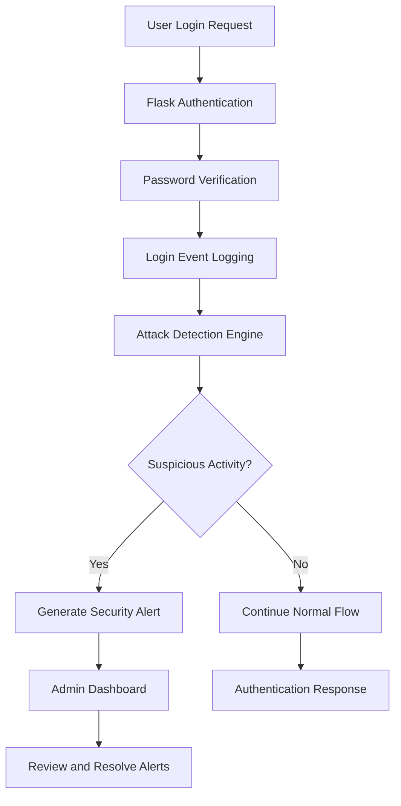

# 🛡️ SentinelAuth – Login Attack Detection System

<p align="center">
  
  
  
  
  
</p>

<p align="center">
  A Flask-based authentication security monitoring system designed to detect suspicious login activities, identify common authentication attacks, and generate security alerts.
</p>

---

## 📌 Overview

**SentinelAuth** is a login attack detection and monitoring application that helps identify suspicious authentication patterns.

It monitors login events and analyzes failed authentication attempts using IP addresses, usernames, and time-based detection rules. When suspicious activity is identified, the system generates security alerts that administrators can review through a centralized dashboard.

The project combines authentication security, attack-pattern detection, event logging, and administrative monitoring in one application.

## ✨ Key Features

- 🔐 **Secure Authentication:** User registration, login, password hashing, and session management.
- 👥 **Role-Based Access Control:** Separate administrator and standard-user permissions.
- 🚨 **Brute-Force Detection:** Identifies repeated failed login attempts from a single IP address.
- 🎯 **Password Spraying Detection:** Identifies attempts involving multiple usernames from one IP address.
- 🌐 **Distributed Attack Detection:** Identifies multiple IP addresses targeting the same username.
- 📊 **Admin Dashboard:** Displays authentication statistics, events, and security alerts.
- 📝 **Login Event Logging:** Records successful and unsuccessful authentication attempts.
- 🛡️ **CSRF Protection:** Protects POST requests using Flask-WTF.
- 🔒 **Security Headers:** Implements browser security headers and Content Security Policy.
- ⚡ **Rate-Limiting Infrastructure:** Flask-Limiter configured with Redis storage.
- 🧪 **Automated Testing:** Pytest test suite covering authentication and security functionality.

## 🧠 Attack Detection Mechanism

SentinelAuth uses time-window-based rules to identify suspicious login patterns.

| Attack Type | Detection Condition |
|---|---|
| Brute Force | 5 or more failed login attempts from one IP within 5 minutes |
| Password Spraying | 10 or more distinct usernames targeted from one IP within 10 minutes |
| Distributed Targeting | 5 or more distinct IP addresses targeting one username within 10 minutes |

### Detection Workflow

1. A user submits login credentials.
2. The application validates the credentials.
3. The login attempt is recorded with its username, IP address, timestamp, and result.
4. The detection engine analyzes recent authentication events.
5. If an attack threshold is reached, a security alert is generated.
6. Administrators can inspect and resolve alerts through the dashboard.

## 🏗️ System Architecture



### Technology Stack

| Technology | Purpose |
|---|---|
| Python | Core application logic |
| Flask | Backend web framework |
| Flask-SQLAlchemy | Database integration and ORM |
| SQLite | Application database |
| Redis | Rate-limit storage backend |
| Flask-Limiter | Request rate limiting |
| Flask-WTF | CSRF protection |
| Werkzeug | Password hashing |
| HTML & CSS | Responsive dashboard interface |
| Chart.js | Dashboard data visualization |
| Pytest | Automated testing |
| Docker | Container support |

## 📁 Project Structure

```text
sentinelauth/
│
├── app/
│   ├── __init__.py          # Flask application factory and configuration
│   ├── models.py            # Database models
│   ├── routes.py            # Application routes
│   ├── security.py          # Security and attack detection logic
│   │
│   ├── templates/           # HTML templates
│   └── static/              # CSS and static assets
│
├── tests/
│   ├── conftest.py           # Pytest fixtures
│   └── test_app.py           # Automated test cases
│
├── instance/                 # Local database and instance data
├── .env.example              # Environment variable template
├── .gitignore
├── Dockerfile
├── docker-compose.yml
├── requirements.txt
├── pytest.ini
├── README.md
└── run.py                    # Application entry point
```

## ⚙️ Installation and Setup

### Prerequisites

- Python 3.12+
- Git
- Docker Desktop (for Redis)
- Redis 7

### 1. Clone the Repository

```bash
git clone https://github.com/abhishek123pal/sentinelauth-login-attack-detection.git

cd sentinelauth-login-attack-detection
```

### 2. Create a Virtual Environment

**Windows:**

```powershell
python -m venv venv
venv\Scripts\activate
```

**Linux / macOS:**

```bash
python3 -m venv venv
source venv/bin/activate
```

### 3. Install Dependencies

```bash
pip install -r requirements.txt
```

### 4. Configure Environment Variables

Create a `.env` file in the root directory using `.env.example` as a template.

Example:

```env
SECRET_KEY=replace-with-a-secure-random-secret
DATABASE_URL=sqlite:///sentinelauth.db

ADMIN_USERNAME=admin
ADMIN_PASSWORD=replace-with-a-strong-password

COOKIE_SECURE=0
FLASK_DEBUG=0

RATELIMIT_STORAGE_URI=redis://localhost:6379/0
```

**Important:** Never commit your `.env` file or production credentials to GitHub.

### 5. Start Redis

Run Redis using Docker:

```bash
docker run -d \
  --name sentinel-redis \
  -p 6379:6379 \
  redis:7-alpine
```

Verify the Redis connection:

```bash
docker exec sentinel-redis redis-cli ping
```

Expected response:

```text
PONG
```

### 6. Run the Application

```bash
python run.py
```

Open your browser:

```text
http://127.0.0.1:5000
```

## 🧪 Running Tests

Execute the automated test suite:

```bash
python -m pytest -v
```

### Test Coverage

| Test Case | Purpose |
|---|---|
| Health Check | Verifies application availability |
| Failed Login Logging | Checks unsuccessful login event recording |
| Admin Authentication | Verifies admin login and dashboard access |
| Authorization | Ensures normal users cannot access admin functionality |
| Brute-Force Detection | Checks repeated failed login detection |
| Password Spraying | Checks multiple username targeting detection |
| Distributed Targeting | Checks multiple IP targeting detection |
| Alert Deduplication | Prevents duplicate security alerts |
| CSRF Validation | Rejects requests without valid CSRF tokens |
| Security Headers | Verifies configured HTTP security headers |

**Latest test result: 10 passed**

## 🔐 Security Considerations

SentinelAuth incorporates several defensive security practices:

- Passwords are stored using secure password hashing rather than plaintext.
- CSRF protection is enabled for state-changing requests.
- Session cookies use HTTP-only and SameSite settings.
- Security headers help mitigate common browser-based attacks.
- Login activity is recorded for security analysis.
- Redis-backed rate limiting is configured to support request throttling.

> **Note:** This project is currently a development-stage security application. Production deployment requires additional hardening, including secure secret management, HTTPS, Redis authentication, production-grade WSGI hosting, and runtime verification of rate limiting.

## 🚀 Future Improvements

- [ ] Real-time security alert notifications.
- [ ] Advanced IP reputation and threat intelligence integration.
- [ ] Geographical visualization of suspicious login sources.
- [ ] Improved anomaly detection using machine learning.
- [ ] Centralized logging and monitoring.
- [ ] Production deployment using Gunicorn and Docker Compose.
- [ ] Integration with external security monitoring platforms.

## 🎯 Project Objectives

The primary objective of SentinelAuth is to demonstrate practical implementation of authentication security, suspicious activity detection, backend development, and security monitoring.

It provides hands-on experience with:

- Authentication and authorization.
- Cybersecurity fundamentals.
- Backend application architecture.
- Database-driven event analysis.
- Redis-based rate-limiting infrastructure.
- Automated testing and application security.

## 👨‍💻 Author

**Abhishek Pal**

B.Tech – Information Technology

- GitHub: [abhishek123pal](https://github.com/abhishek123pal)
- LinkedIn: [Abhishek Pal](https://linkedin.com/in/abhishek-pal-972846305)

---

<p align="center">
  <strong>🛡️ SentinelAuth — Detect. Monitor. Secure.</strong>
</p>

<p align="center">
  Built as a hands-on cybersecurity and backend engineering project.
</p>
